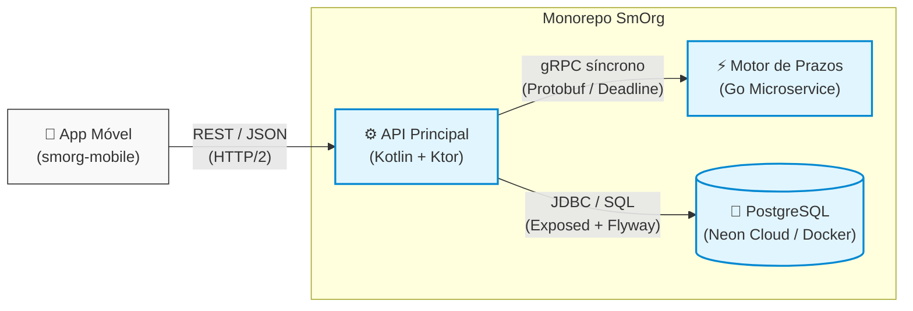

# SmOrg (Smart Organization) - API

[](https://github.com/Goguel/smorg-api/actions/workflows/ci.yml)
[](LICENSE)

Backend do sistema **SmOrg**, um ecossistema de gestão de ativos físicos e controle de empréstimos laboratoriais baseado em aproximação por **NFC**, projetado com foco em **atrito zero** para ambientes universitários. Desenvolvido para a disciplina DIM0547 — Desenvolvimento de Sistemas Web II (UFRN).

---

## 📖 O que é o SmOrg

Em laboratórios universitários, o controle de materiais (multímetros, osciloscópios, kits didáticos e componentes) frequentemente depende de planilhas manuais ou anotações em papel. Esse modelo gera lentidão, filas no balcão e alta taxa de erros ou esquecimentos no registro de devoluções e prazos.

O **SmOrg** soluciona esse gargalo ao integrar tags NFC aos equipamentos físicos e aos crachás dos alunos. Com uma aproximação de smartphone, o sistema identifica instantaneamente o ativo, valida o perfil acadêmico do solicitante e registra o empréstimo em milissegundos.

A plataforma adota uma arquitetura poliglota distribuída: a orquestração central e a persistência relacional residem em um serviço **Kotlin com Ktor**, enquanto as regras acadêmicas dinâmicas de contagem de dias úteis e prazos de devolução são delegadas a um microsserviço isolado de alta performance em **Go**, conectado por **gRPC**.

---

## 🏛️ Arquitetura do Sistema



* **API Principal (Kotlin / Ktor):** Orquestra CRUDs, executa a autenticação/autorização, expõe endpoints REST com especificação RFC 9457 (*Problem Details*) e Swagger UI. O domínio é estritamente puro (Clean Architecture).
* **Microsserviço de Prazos (Go):** Motor determinístico que calcula a data limite de devolução com base no calendário institucional da UFRN (descontando fins de semana e feriados) e nos perfis (`ALUNO`: 3 dias úteis, `MONITOR`: 7 dias úteis, `PROFESSOR`: 15 dias úteis).
* **Comunicação gRPC (`protos/`):** Contrato Protocol Buffers padronizado sob governança do Buf CLI (`buf.yaml`), com stubs gerados automaticamente e suporte a degradação graciosa na API.
* **Banco de Dados:** PostgreSQL 16 com migrações versionadas via Flyway (`V1` e `V2`).

---

## 🌐 No Ar (Ambiente de Produção)

* **URL Pública da API (Render):** `https://smorg-api.onrender.com`
* **Documentação Interativa (Swagger UI):** `https://smorg-api.onrender.com/docs`
* **JSON Schema (OpenAPI):** `https://smorg-api.onrender.com/openapi.json`
* **Banco Gerenciado:** PostgreSQL hospedado no [Neon Serverless](https://neon.tech).

> **Nota sobre o serviço Go em nuvem:** Conforme deliberado em `RUBRICAS.md §Sprint 2` e documentado na [ADR 002](docs/decisoes/0002-implantacao-nuvem.md), em plataformas gratuitas de nuvem a comunicação gRPC privada não está disponível. Por isso, a API na nuvem opera com política de *fallback* gracioso automático, mantendo-se sempre ativa. O ambiente distribuído completo com o serviço Go é executado e avaliado via `docker compose up`.

---

## 📋 Pré-requisitos

Para executar o projeto do zero, você precisa apenas de:
* [Docker](https://docs.docker.com/get-docker/) (versão 24.0 ou superior) com [Docker Compose](https://docs.docker.com/compose/) instalado.

*(Opcional para desenvolvimento nativo sem Docker: Java 21+, Go 1.23+ e `mise`).*

---

## 🚀 Como Rodar em Menos de 10 Minutos

Na raiz do repositório, execute um único comando:

```bash
docker compose up --build -d
```

O Docker Compose compilará as imagens multi-stage e iniciará os três serviços de forma coordenada:
1. `postgres` (Banco de dados relacional na porta `5432`)
2. `servico-prazos` (Microsserviço Go gRPC na porta `50051`)
3. `api` (API Principal Ktor na porta `8080`)

Para conferir o status de saúde dos serviços:
```bash
docker compose ps
```
*Todos os serviços exibirão o estado `healthy`.*

### Variáveis de Ambiente Suportadas
| Variável | Descrição | Exemplo Padrão |
|---|---|---|
| `STORAGE_JDBCURL` | JDBC Connection String do Postgres | `jdbc:postgresql://postgres:5432/smorg` |
| `STORAGE_USER` | Usuário do banco de dados | `smorg` |
| `STORAGE_PASSWORD` | Senha do banco de dados | `smorg` |
| `PRAZOS_GRPC_HOST` | Endereço do microsserviço Go | `servico-prazos:50051` |
| `PORT` | Porta HTTP da API Ktor | `8080` |

---

## 🧪 Como Rodar os Testes

A suíte cobre testes unitários, testes de integração reais com Testcontainers, testes de arquitetura com ArchUnit e testes gRPC em memória:

```bash
# Executa todos os testes locais via mise
mise run test

# Ou execute separadamente por módulo:
# 1. Testes do Microsserviço Go (Domínio, Prazos e Servidor gRPC via bufconn)
cd services && go test -v ./...

# 2. Testes da API Ktor (Unitários, ArchUnit, Testcontainers e Cliente gRPC)
cd api && ./gradlew test
```

### O que cada suíte valida:
* **`services/prazos/*_test.go`:** Regras puras de dias úteis com fins de semana, feriados acadêmicos UFRN e cancelamento de `context.Context`.
* **`services/grpcapi/*_test.go`:** Adaptador gRPC com serialização binária, códigos de status (`INVALID_ARGUMENT`, `DEADLINE_EXCEEDED`) sobre conexão `bufconn`.
* **`api/.../CalculadorDePrazosGrpcTest.kt`:** Cliente gRPC no Ktor com corrotinas, respeito a deadlines e acionamento de contingência/fallback.
* **`api/.../ArquiteturaTest.kt`:** ArchUnit conferindo que `com.smorg.domain` não importa frameworks, banco, adaptadores nem gRPC.
* **`api/.../BancoIntegrationTest.kt`:** Testcontainers subindo PostgreSQL real e aplicando migrações Flyway.

---

## 📡 Exemplos de Chamadas à API

> **Dica:** Os exemplos abaixo utilizam o endpoint local (`http://localhost:8080`), mas podem ser executados diretamente contra o ambiente em produção substituindo a URL base por `https://smorg-api.onrender.com`.

### 1. Cadastrar um Equipamento com Tag NFC
```bash
curl -X POST http://localhost:8080/api/v1/equipamentos \
  -H "Content-Type: application/json" \
  -d '{
    "nome": "Osciloscópio Digital 100MHz",
    "nfc_tag_id": "04A1B2C3D4",
    "categoria": "ELETRONICA"
  }'
```
**Resposta esperada (`201 Created`):**
```json
{
  "id": "e3b0c442-98fc-1c14-9afb-4c0000000001",
  "nome": "Osciloscópio Digital 100MHz",
  "nfc_tag_id": "04A1B2C3D4",
  "status": "DISPONIVEL",
  "categoria": "ELETRONICA"
}
```

### 2. Registrar Retirada (Abertura de Empréstimo via NFC com cálculo gRPC)
```bash
curl -X POST http://localhost:8080/api/v1/emprestimos \
  -H "Content-Type: application/json" \
  -d '{
    "usuario_id": "11111111-1111-1111-1111-111111111111",
    "nfc_tag_id": "04A1B2C3D4",
    "perfil_usuario": "ALUNO"
  }'
```
**Resposta esperada (`201 Created`):**
```json
{
  "id": "22222222-2222-2222-2222-222222222222",
  "usuario_id": "11111111-1111-1111-1111-111111111111",
  "equipamento_id": "e3b0c442-98fc-1c14-9afb-4c0000000001",
  "data_retirada": "2026-11-05T10:00:00Z",
  "data_devolucao_prevista": "2026-11-10T23:59:59Z",
  "status": "ATIVO",
  "devolvido_com_atraso": false
}
```

### 3. Registrar Devolução por Aproximação NFC
```bash
curl -X POST http://localhost:8080/api/v1/emprestimos/devolucao \
  -H "Content-Type: application/json" \
  -d '{
    "nfc_tag_id": "04A1B2C3D4"
  }'
```
**Resposta esperada (`200 OK`):**
```json
{
  "id": "22222222-2222-2222-2222-222222222222",
  "usuario_id": "11111111-1111-1111-1111-111111111111",
  "equipamento_id": "e3b0c442-98fc-1c14-9afb-4c0000000001",
  "status": "DEVOLVIDO",
  "devolvido_com_atraso": false
}
```

---

## 📑 Decisões Arquiteturais (ADRs)

* [**ADR 001 — Responsabilidade e Isolamento do Microsserviço em Go**](docs/decisoes/0001-microsservico-go.md): Justificativa da criação do motor de regras em Go, isolamento de ciclo de vida e garantias de não compartilhamento de banco de dados.
* [**ADR 002 — Estratégia de Implantação, Banco Gerenciado e Degradação Graciosa**](docs/decisoes/0002-implantacao-nuvem.md): Estrutura de deploy no Render, uso do Neon Serverless PostgreSQL e política de tolerância a falhas na ausência do gRPC em nuvem.

---

## 📄 Licença

Este projeto está licenciado sob os termos da licença **MIT**. Consulte o arquivo [LICENSE](LICENSE) para obter mais informações.
